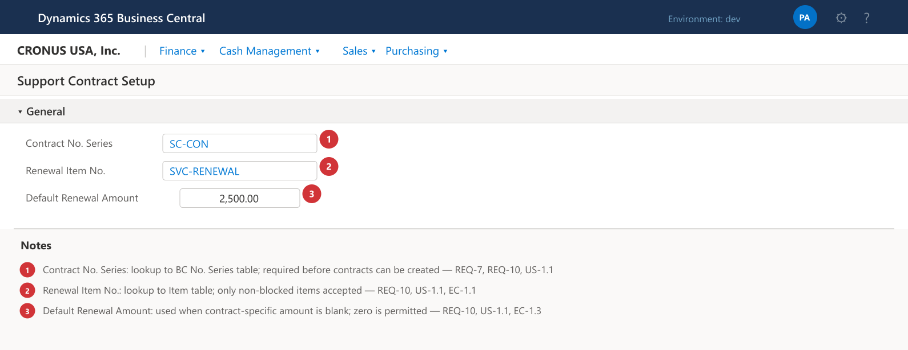
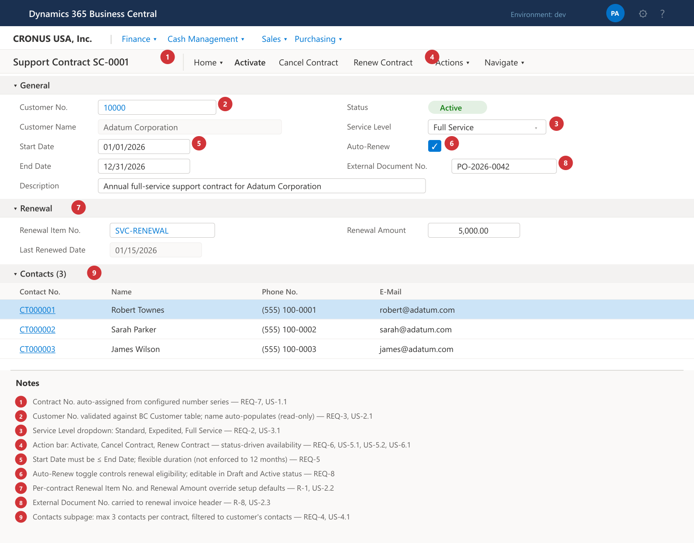
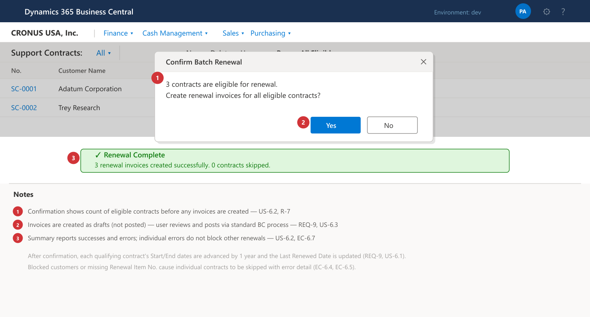
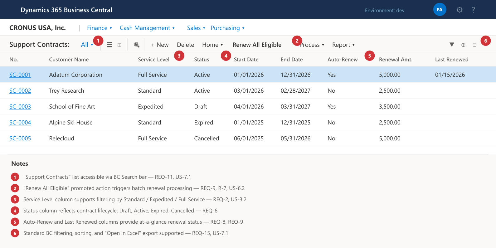
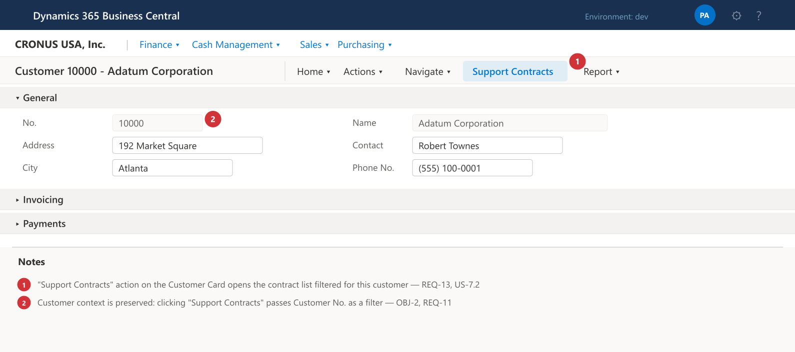

# Overview

This document translates the Functional Requirements Document (FRD v1.0) into a product-level specification for a Business Central Per-Tenant Extension built in AL. It defines the AL objects, data structures, user stories, and edge-case handling needed to implement the Support Contracts solution for Acme Co.

The extension will allow Acme Co. to create and manage customer support contracts within Business Central, track service levels and contacts, and automate annual renewal invoicing — all without leaving the BC environment.

# Product Goals & Success Metrics

| Goal | Metric |
|------|--------|
| Eliminate external contract tracking | 100% of active contracts managed in BC within 30 days of go-live |
| Reduce renewal administration effort | Renewal invoices generated in ≤ 2 clicks (or 0 clicks if batch-processed) |
| Improve contract visibility | Any user can find a contract's status and expiry in ≤ 10 seconds via the list page |
| Ensure data integrity | Zero orphaned contracts (every contract linked to a valid customer) |

# Personas

| Persona | Role | Key Activities |
|---------|------|----------------|
| **Sarah — Contract Administrator** | Office Manager / Admin | Creates contracts, manages contacts, runs renewals, maintains setup |
| **Mike — Sales Representative** | Account Manager | Views contract status from the customer card, checks service level and expiry |
| **Dana — Finance Manager** | AR / Billing | Reviews and posts renewal invoices, verifies amounts |
| **Admin — System Administrator** | IT / BC Admin | Configures setup, assigns permission sets, manages number series |

# Feature 1 — Support Contract Setup & Configuration

*FRD Reference: REQ-7, REQ-10*

## Description

A single-record setup table and page where administrators configure extension-wide defaults before any contracts are created.

## Setup Fields

| Field | Type | Description |
|-------|------|-------------|
| Contract No. Series | Code (No. Series) | Number series for generating contract numbers. |
| Renewal Item No. | Code (Item No.) | The BC item placed on renewal sales invoice lines. |
| Default Renewal Amount | Decimal | Default unit price for the renewal invoice line; can be overridden per contract. |

## Wireframe: Support Contract Setup



## User Stories

### US-1.1: Configure the Extension (Primary)

**As** Admin,
**I want to** set the contract number series, renewal item, and default renewal amount in one setup page,
**so that** contracts and renewal invoices are created with consistent defaults.

**Acceptance Criteria**

- The setup page is accessible from the BC search bar ("Support Contract Setup").
- The Contract No. Series field validates against the No. Series table.
- The Renewal Item No. field validates against the Item table and only accepts non-blocked items.
- The Default Renewal Amount allows zero (for contracts that may have no monetary renewal).
- Only one setup record can exist (singleton pattern).

### US-1.2: Prevent Contract Creation Without Setup

**As** the system,
**I want to** display an error when a user attempts to create a contract before the setup record is complete,
**so that** contracts are not created without a valid number series.

**Acceptance Criteria**

- If Contract No. Series is blank when a user inserts a new contract, an error message is raised: *"Please complete the Support Contract Setup before creating contracts."*

### Edge Cases

| ID | Scenario | Expected Behavior |
|----|----------|-------------------|
| EC-1.1 | Renewal Item No. is later blocked on the Item card | The next renewal run displays an error for that contract and skips it, allowing other renewals to proceed. |
| EC-1.2 | User changes the number series after contracts already exist | Existing contract numbers are unaffected; new contracts use the new series. |
| EC-1.3 | Default Renewal Amount is changed | Only affects new contracts or contracts still using the default; contracts with a contract-specific amount are unaffected. |

# Feature 2 — Contract Creation & Management

*FRD Reference: REQ-1, REQ-3, REQ-5, REQ-7, R-1, R-8*

## Description

Users create support contract records linked to existing BC customers. Each contract captures dates, service level, renewal preferences, and optional notes.

## Contract Card Fields

| Field | Type | Description |
|-------|------|-------------|
| No. | Code | Auto-assigned from the configured number series. |
| Customer No. | Code (Customer) | Lookup to the Customer table. Mandatory. |
| Customer Name | Text | Auto-populated from the customer record (non-editable). |
| Service Level | Enum | Standard, Expedited, or Full Service. Mandatory. |
| Status | Enum | Draft, Active, Expired, Cancelled. Default: Draft. |
| Start Date | Date | Contract coverage start. Mandatory for activation. |
| End Date | Date | Contract coverage end. Mandatory for activation. |
| Auto-Renew | Boolean | Default: No. |
| Renewal Amount | Decimal | Defaults from setup; can be overridden per contract (R-1). |
| Renewal Item No. | Code (Item No.) | Defaults from setup; can be overridden per contract. |
| External Document No. | Text | Optional PO or reference number carried to renewal invoices (R-8). |
| Last Renewed Date | Date | System-populated on renewal. Read-only. |
| Description | Text | Free-text notes or special terms. |

## Wireframe: Support Contract Card



## User Stories

### US-2.1: Create a New Contract (Primary)

**As** Sarah (Contract Administrator),
**I want to** create a support contract by selecting a customer, choosing a service level, and entering start/end dates,
**so that** the customer's support coverage is formally recorded in Business Central.

**Acceptance Criteria**

- A new contract is created from the Support Contracts list page or directly via the contract card.
- The system assigns a contract number automatically.
- Customer No. is validated against the Customer table; customer name auto-fills.
- Start Date must be ≤ End Date; an error is shown if violated.
- Status defaults to Draft.
- All mandatory fields (Customer No., Service Level, Start Date, End Date) must be populated before the contract can be activated.

### US-2.2: Set a Contract-Specific Renewal Amount

**As** Sarah,
**I want to** override the default renewal amount on an individual contract,
**so that** customers with negotiated pricing receive correctly priced renewal invoices.

**Acceptance Criteria**

- Renewal Amount is editable on the contract card when status is Draft or Active.
- Clearing the field reverts to the setup default during renewal processing.

### US-2.3: Record an External Document Reference

**As** Sarah,
**I want to** enter the customer's purchase order number on the contract,
**so that** renewal invoices include the PO number and the customer can match them to their records.

**Acceptance Criteria**

- External Document No. is editable when status is Draft or Active.
- The value is copied to the External Document No. field on the generated sales invoice header during renewal.

### Edge Cases

| ID | Scenario | Expected Behavior |
|----|----------|-------------------|
| EC-2.1 | User selects a blocked customer | The system allows selection but displays a warning: *"Customer {No.} is blocked."* The contract can still be saved in Draft status. |
| EC-2.2 | User enters Start Date after End Date | Validation error: *"Start Date must be on or before End Date."* |
| EC-2.3 | User deletes the customer record after a contract is linked | BC standard referential integrity prevents deletion when related records exist. The user must cancel/remove the contract first. |
| EC-2.4 | Customer No. is changed on a Draft contract | Contact subpage is cleared because contacts are customer-specific. User is warned before the change. |
| EC-2.5 | User attempts to edit a Cancelled or Expired contract | Non-status fields are non-editable. The user must create a new contract. |

# Feature 3 — Service Levels

*FRD Reference: REQ-2*

## Description

A fixed enum defines the three service tiers. The enum is used on the contract card and as a filter on the list page.

## Enum Values

| Value | Name | Caption |
|-------|------|---------|
| 0 | Standard | Standard |
| 1 | Expedited | Expedited |
| 2 | FullService | Full Service |

## User Stories

### US-3.1: Select a Service Level (Primary)

**As** Sarah,
**I want to** choose from Standard, Expedited, or Full Service when creating a contract,
**so that** the agreed support tier is clearly recorded and visible to anyone viewing the contract.

**Acceptance Criteria**

- Service Level is a mandatory dropdown with exactly three options.
- The selected value is displayed on the contract card and list.
- Service Level is editable when the contract is in Draft status.
- Changing the service level on an Active contract requires confirmation.

### US-3.2: Filter Contracts by Service Level

**As** Mike (Sales Rep),
**I want to** filter the contract list to see only Full Service contracts,
**so that** I can quickly identify which customers have premium coverage.

**Acceptance Criteria**

- The Service Level column on the list page supports standard BC filtering.

### Edge Cases

| ID | Scenario | Expected Behavior |
|----|----------|-------------------|
| EC-3.1 | Service level is blank on activation attempt | Validation error: *"Service Level must have a value."* |
| EC-3.2 | User changes service level on an Active contract | Confirmation dialog: *"Changing the service level on an active contract may affect support obligations. Continue?"* If confirmed, the change is saved. |

# Feature 4 — Contract Contacts

*FRD Reference: REQ-4*

## Description

A subpage on the contract card allows users to link up to three BC contact records per contract. Contacts must belong to the company contact associated with the contract's customer.

## Contact Subpage Fields

| Field | Type | Description |
|-------|------|-------------|
| Contract No. | Code | Parent contract (hidden, auto-set). |
| Line No. | Integer | Auto-incremented line identifier. |
| Contact No. | Code (Contact) | Lookup to Contact table, filtered to the customer's company contact. |
| Contact Name | Text | Auto-populated from the contact record. |
| Phone No. | Text | Auto-populated from the contact record. |
| E-Mail | Text | Auto-populated from the contact record. |

## User Stories

### US-4.1: Add Contacts to a Contract (Primary)

**As** Sarah,
**I want to** add up to three contacts from the customer's contact list to the support contract,
**so that** we know which individuals at the customer are authorized to request support.

**Acceptance Criteria**

- The Contact No. lookup is filtered to contacts related to the contract's customer.
- Contact Name, Phone No., and E-Mail auto-populate upon selection.
- The system prevents adding more than three contact lines. When a fourth line is attempted, an error is displayed: *"A maximum of 3 contacts are allowed per contract."*
- Contacts can be added or removed when the contract is in Draft or Active status.

### US-4.2: View Contact Details from the Contract

**As** Mike,
**I want to** see the contact name, phone, and email directly on the contract card,
**so that** I can quickly reach the right person without navigating away.

**Acceptance Criteria**

- Contact details (name, phone, email) are visible in the subpage without opening the contact card.

### Edge Cases

| ID | Scenario | Expected Behavior |
|----|----------|-------------------|
| EC-4.1 | User attempts to add a 4th contact | Error message: *"A maximum of 3 contacts are allowed per contract."* |
| EC-4.2 | The same contact is added twice | Validation error: *"Contact {No.} is already linked to this contract."* |
| EC-4.3 | Customer No. is changed on the contract (Draft) | All existing contact lines are deleted with a warning, since they may no longer be valid for the new customer. |
| EC-4.4 | A linked contact is deleted from the Contact table | BC prevents deletion if related records exist, or the contact line becomes invalid and should be removed. |
| EC-4.5 | Customer has no contacts in BC | The subpage is empty. The user can still activate the contract (contacts are optional). |

# Feature 5 — Contract Status Lifecycle

*FRD Reference: REQ-6*

## Description

Contracts follow a defined status lifecycle managed through actions on the contract card. Status controls field editability and determines eligibility for renewal.

## Status Transition Diagram

```
  ┌─────────┐         ┌─────────┐         ┌─────────┐
  │  Draft   │──────►  │ Active  │──────►  │ Expired │
  └─────────┘         └─────────┘         └─────────┘
       │                    │
       │                    │
       ▼                    ▼
  ┌───────────┐       ┌───────────┐
  │ Cancelled │       │ Cancelled │
  └───────────┘       └───────────┘
```

## Field Editability by Status

| Field | Draft | Active | Expired | Cancelled |
|-------|:-----:|:------:|:-------:|:---------:|
| Customer No. | ✓ | — | — | — |
| Service Level | ✓ | Confirm | — | — |
| Start Date | ✓ | — | — | — |
| End Date | ✓ | — | — | — |
| Auto-Renew | ✓ | ✓ | — | — |
| Renewal Amount | ✓ | ✓ | — | — |
| Renewal Item No. | ✓ | ✓ | — | — |
| External Document No. | ✓ | ✓ | — | — |
| Description | ✓ | ✓ | — | — |
| Contacts (subpage) | ✓ | ✓ | — | — |

## User Stories

### US-5.1: Activate a Contract (Primary)

**As** Sarah,
**I want to** activate a draft contract once all details are confirmed,
**so that** the contract is officially in effect and visible as "Active" to the team.

**Acceptance Criteria**

- An "Activate" action is available on the contract card when status is Draft.
- Activation validates that all mandatory fields are populated (Customer No., Service Level, Start Date, End Date).
- If validation passes, status changes to Active.
- If validation fails, a descriptive error message identifies the missing field(s).

### US-5.2: Cancel a Contract

**As** Sarah,
**I want to** cancel a contract that is no longer needed,
**so that** it is marked as terminated and excluded from renewal processing.

**Acceptance Criteria**

- A "Cancel" action is available when status is Draft or Active.
- A confirmation dialog is shown: *"Are you sure you want to cancel this contract? This action cannot be undone."*
- On confirmation, status changes to Cancelled and Auto-Renew is set to No.
- Cancelled contracts remain in the system for historical reference.

### US-5.3: Contract Expires Naturally

**As** the system,
**I want to** reflect that a contract has expired when its end date passes without renewal,
**so that** expired contracts are distinguishable from active ones.

**Acceptance Criteria**

- When the current work date is past the End Date and the contract status is Active, the status displays as Expired.
- Expired contracts are excluded from renewal processing.

### Edge Cases

| ID | Scenario | Expected Behavior |
|----|----------|-------------------|
| EC-5.1 | User tries to activate a contract with missing mandatory fields | Error listing all missing fields, e.g., *"Start Date must have a value. End Date must have a value."* |
| EC-5.2 | User tries to re-activate a Cancelled contract | Action is not available. Cancelled is a terminal status. |
| EC-5.3 | User tries to re-activate an Expired contract | Action is not available. The user should create a new contract or use the renewal process. |
| EC-5.4 | An Active contract's end date is in the past but Auto-Renew is on | The contract shows as Expired. The renewal process should have been run before expiry. A renewal can still be initiated manually. |

# Feature 6 — Auto-Renewal & Invoice Generation

*FRD Reference: REQ-8, REQ-9, R-1, R-8*

## Description

The renewal process identifies eligible contracts and creates draft sales invoices in BC. After invoice creation, contract dates are advanced by one year and the renewal date is stamped.

## Renewal Eligibility Criteria

A contract is eligible for renewal when all of the following are true:

1. Status is Active (or recently expired, within a grace window).
2. Auto-Renew is enabled.
3. The contract has not already been renewed for the current period (Last Renewed Date < current End Date).

## Renewal Invoice Mapping

| Sales Invoice Field | Source |
|---------------------|--------|
| Customer No. | Contract → Customer No. |
| External Document No. | Contract → External Document No. |
| Invoice Line → Item No. | Contract → Renewal Item No. (or Setup default) |
| Invoice Line → Unit Price | Contract → Renewal Amount (or Setup default) |
| Invoice Line → Quantity | 1 |

## Wireframe: Batch Renewal Confirmation



## User Stories

### US-6.1: Renew a Single Contract (Primary)

**As** Sarah,
**I want to** run the renewal action on an individual contract,
**so that** a draft sales invoice is created for that customer and the contract dates are extended.

**Acceptance Criteria**

- A "Renew Contract" action is available on the contract card when the contract is Active and Auto-Renew is enabled.
- Running the action creates a single draft Sales Invoice in BC with the correct customer, item, amount, and external document no.
- The contract's Start Date and End Date are each advanced by one year.
- The Last Renewed Date is set to today's work date.
- A confirmation message displays: *"Renewal invoice {Invoice No.} has been created."*

### US-6.2: Batch Renew All Eligible Contracts (R-7)

**As** Sarah,
**I want to** process all eligible renewals in one action from the contract list page,
**so that** I don't have to open each contract individually during the renewal period.

**Acceptance Criteria**

- A "Renew All Eligible" action is available on the Support Contracts list page.
- The system identifies all contracts matching the renewal eligibility criteria.
- A confirmation dialog shows the count of contracts to be renewed: *"X contracts are eligible for renewal. Create invoices?"*
- On confirmation, draft sales invoices are created for each eligible contract.
- A summary message reports results: *"Y invoices created. Z contracts skipped due to errors."*
- Errors on individual contracts do not block processing of remaining contracts.

### US-6.3: Review the Renewal Invoice Before Posting

**As** Dana (Finance Manager),
**I want to** review the automatically generated renewal invoice before it is posted,
**so that** I can verify amounts, adjust if needed, and ensure billing accuracy.

**Acceptance Criteria**

- Renewal invoices are created in Draft (unposted) status.
- The invoice is a standard BC Sales Invoice and can be edited, posted, or deleted using normal BC processes.
- No automatic posting occurs.

### Edge Cases

| ID | Scenario | Expected Behavior |
|----|----------|-------------------|
| EC-6.1 | Renewal is run on a contract that has already been renewed for the current period | Error: *"This contract has already been renewed. Last renewed: {date}."* No duplicate invoice is created. |
| EC-6.2 | Renewal Item No. is blank on both the contract and setup | Error: *"A Renewal Item No. must be specified in the contract or Support Contract Setup."* |
| EC-6.3 | Renewal Amount is zero | The invoice is created with a zero-amount line. This is allowed (e.g., complimentary renewals). |
| EC-6.4 | The configured renewal item is blocked | Error for that contract: *"Item {No.} is blocked and cannot be used on invoices."* The contract is skipped in batch processing. |
| EC-6.5 | The customer is blocked at time of renewal | Error: *"Customer {No.} is blocked. The renewal invoice cannot be created."* The contract is skipped. |
| EC-6.6 | Auto-Renew is disabled on an Active contract | The contract is excluded from both single and batch renewal processing. The "Renew Contract" action is hidden or disabled. |
| EC-6.7 | Batch renewal is run with no eligible contracts | Message: *"No contracts are currently eligible for renewal."* |
| EC-6.8 | User deletes the draft renewal invoice after it was created | The contract retains the advanced dates and Last Renewed Date. The user can manually create a new invoice if needed. |

# Feature 7 — Contract List & Navigation

*FRD Reference: REQ-11, REQ-12, REQ-13, REQ-15, REQ-16*

## Description

A list page displays all support contracts with filtering, sorting, and drill-down capability. Navigation from the Customer Card provides contextual access.

## List Page Columns

| Column | Filterable | Sortable |
|--------|:----------:|:--------:|
| No. | ✓ | ✓ |
| Customer No. | ✓ | ✓ |
| Customer Name | ✓ | ✓ |
| Service Level | ✓ | ✓ |
| Status | ✓ | ✓ |
| Start Date | ✓ | ✓ |
| End Date | ✓ | ✓ |
| Auto-Renew | ✓ | ✓ |
| Renewal Amount | — | ✓ |
| Last Renewed Date | ✓ | ✓ |

## Wireframe: Support Contracts List



## User Stories

### US-7.1: Browse and Filter Contracts (Primary)

**As** Sarah,
**I want to** view a list of all support contracts and filter by status, customer, or service level,
**so that** I can quickly find the contract I'm looking for.

**Acceptance Criteria**

- The Support Contracts list page is accessible via the BC search bar.
- All columns listed above are present and support standard BC filtering and sorting.
- Clicking a contract row opens the contract card.
- The list supports BC's standard "Open in Excel" / "Edit in Excel" functionality.

### US-7.2: Navigate from Customer Card to Contracts

**As** Mike,
**I want to** see how many support contracts a customer has directly from their customer card, and navigate to the list filtered for that customer,
**so that** I can review their coverage without searching manually.

**Acceptance Criteria**

- A "Support Contracts" action or FactBox is available on the standard Customer Card page.
- Selecting it opens the Support Contracts list filtered to contracts for that customer.

## Wireframe: Customer Card Integration



### US-7.3: Identify Expiring Contracts

**As** Sarah,
**I want to** filter the contract list to show contracts expiring within the next 30/60/90 days,
**so that** I can proactively manage upcoming renewals.

**Acceptance Criteria**

- The End Date column supports date range filters using standard BC filter syntax (e.g., `..04/30/26` for all contracts expiring by April 30, 2026).
- Optionally, predefined filter views (e.g., "Expiring in 30 Days") can be saved using BC's bookmark/view functionality.

### Edge Cases

| ID | Scenario | Expected Behavior |
|----|----------|-------------------|
| EC-7.1 | User searches for "Support Contracts" in the BC search bar | The list page appears in search results. |
| EC-7.2 | Customer has no contracts | The list page shows an empty result when filtered for that customer. The Customer Card action/FactBox indicates zero contracts. |

# Feature 8 — Security & Permissions

*FRD Reference: REQ-14*

## Description

A dedicated permission set controls access to all support contract objects. Without the permission set, users cannot access contract pages, tables, or codeunits.

## Permission Set: "Sup. Contract - Full"

| Object Type | Object | Permission |
|-------------|--------|------------|
| Table | Support Contract Setup | Read, Insert, Modify, Delete |
| Table | Support Contract | Read, Insert, Modify, Delete |
| Table | Support Contract Contact | Read, Insert, Modify, Delete |
| Page | Support Contract Setup | Execute |
| Page | Support Contract Card | Execute |
| Page | Support Contracts (List) | Execute |
| Page | Support Contract Contacts (Subpage) | Execute |
| Codeunit | Support Contract Renewal Mgt. | Execute |

## User Stories

### US-8.1: Grant Contract Access to a User (Primary)

**As** Admin,
**I want to** assign the "Sup. Contract - Full" permission set to users who need to manage support contracts,
**so that** only authorized personnel can view and modify contract data.

**Acceptance Criteria**

- The permission set is visible in the BC permission set list.
- Assigning it to a user grants full access to all support contract functionality.
- A user without the permission set receives a permission error when attempting to access any support contract page.

### US-8.2: Restrict Access from Unauthorized Users

**As** Admin,
**I want to** ensure that users without the permission set cannot view or modify contract data,
**so that** sensitive contract information is protected.

**Acceptance Criteria**

- Users without the permission set cannot open the Support Contract Setup, Contract Card, or Contract List pages.
- The BC search bar does not surface support contract pages for unauthorized users (standard BC behavior when page execution permission is denied).

### Edge Cases

| ID | Scenario | Expected Behavior |
|----|----------|-------------------|
| EC-8.1 | User has the permission set but lacks customer read permissions | The user can open contract pages but will receive errors when the system tries to read customer data. This is expected BC behavior — the user needs sufficient base permissions alongside the contract permission set. |
| EC-8.2 | Permission set is removed from a user who has contracts open | The user can finish their current session, but subsequent attempts to open contract pages will be denied. |

# AL Object Summary

The following AL objects are required for the extension. Object IDs are within the assigned range of 60100–60149.

| Object Type | ID | Name | Purpose |
|-------------|----|------|---------|
| Enum | 60100 | Service Level | Standard, Expedited, Full Service |
| Table | 60100 | Support Contract Setup | Singleton setup record (number series, renewal defaults) |
| Table | 60101 | Support Contract | Contract header: customer, dates, status, renewal fields |
| Table | 60102 | Support Contract Contact | Contract contact lines (max 3 per contract) |
| Page | 60100 | Support Contract Setup | Card page for setup configuration |
| Page | 60101 | Support Contract Card | Card page for contract detail view and actions |
| Page | 60102 | Support Contracts | List page for browsing/filtering all contracts |
| Page | 60103 | Support Contract Contacts | Subpage (ListPart) embedded on the contract card |
| Codeunit | 60100 | Support Contract Install | Install logic (seed setup record, initialize defaults) |
| Codeunit | 60101 | Support Contract Upgrade | Upgrade logic for future version migrations |
| Codeunit | 60102 | Support Contract Renewal Mgt. | Renewal eligibility check, invoice creation, date advancement |
| Permission Set | 60100 | Sup. Contract - Full | Full RIMD access to all support contract objects |

# Data Model Overview

## Table: Support Contract Setup (60100)

| Field | Type | Key | Notes |
|-------|------|-----|-------|
| Primary Key | Code[10] | PK | Always blank (singleton). |
| Contract No. Series | Code[20] | | Relation: No. Series. |
| Renewal Item No. | Code[20] | | Relation: Item. |
| Default Renewal Amount | Decimal | | |

## Table: Support Contract (60101)

| Field | Type | Key | Notes |
|-------|------|-----|-------|
| No. | Code[20] | PK | From number series. |
| Customer No. | Code[20] | | Relation: Customer. |
| Customer Name | Text[100] | | CalcField or FlowField from Customer. |
| Service Level | Enum (Service Level) | | |
| Status | Enum (Contract Status) | | Draft, Active, Expired, Cancelled. |
| Start Date | Date | | |
| End Date | Date | | |
| Auto-Renew | Boolean | | |
| Renewal Amount | Decimal | | |
| Renewal Item No. | Code[20] | | Relation: Item. |
| External Document No. | Text[35] | | |
| Last Renewed Date | Date | | |
| Description | Text[250] | | |

## Table: Support Contract Contact (60102)

| Field | Type | Key | Notes |
|-------|------|-----|-------|
| Contract No. | Code[20] | PK1 | Relation: Support Contract. |
| Line No. | Integer | PK2 | |
| Contact No. | Code[20] | | Relation: Contact. |
| Contact Name | Text[100] | | From Contact. |
| Phone No. | Text[30] | | From Contact. |
| E-Mail | Text[80] | | From Contact. |

# Non-Functional Requirements

| ID | Category | Requirement |
|----|----------|-------------|
| NFR-1 | Compatibility | The extension must be compatible with BC Online (SaaS) version 26.0 and later. |
| NFR-2 | Deployment | Deployed as a Per-Tenant Extension (PTE). No dependency on other third-party extensions. |
| NFR-3 | Performance | Batch renewal of up to 500 contracts should complete within 60 seconds. |
| NFR-4 | Localization | English only for v1.0. Labels and messages should use AL caption properties to support future translation. |
| NFR-5 | Upgrade | Codeunit 60101 (Upgrade) must handle data migration for future schema changes. |
| NFR-6 | Code Standards | AL code must pass the default CodeCop and AppSourceCop analyzers (even though this is a PTE, AppSourceCop compliance is a best practice). |
| NFR-7 | Testing | All critical paths (contract creation, activation, renewal, cancellation) should be covered by automated AL Test codeunits. |

# Open Questions & Decisions

| # | Question | Status | Decision |
|---|----------|--------|----------|
| OQ-1 | Should expired contracts with Auto-Renew be renewable after the end date, or only before? | Open | Current design allows renewal after expiry (grace renewal). Confirm with Acme Co. |
| OQ-2 | Should the renewal process be available as a Job Queue entry for full automation? | Open | v1.0 supports manual batch action. Job Queue integration can be added in v1.1. |
| OQ-3 | Should service level–based default pricing (R-6) be included in v1.0? | Deferred | Excluded from v1.0 per FRD priority. Can be added in a future version. |
| OQ-4 | Should an audit trail / change log be implemented natively or rely on BC's Change Log feature? | Open | Recommend leveraging BC's built-in Change Log for v1.0 to reduce development scope. |
| OQ-5 | Does Acme Co. need multi-currency support for renewal amounts? | Open | v1.0 assumes LCY. If needed, the renewal invoice can be adjusted manually post-creation. |

# Requirement Traceability

| PRD Feature | User Stories | FRD Requirements | FRD Recommendations | Priority |
|-------------|-------------|-------------------|----------------------|----------|
| F1: Setup & Configuration | US-1.1, US-1.2 | REQ-7, REQ-10 | — | Should Have |
| F2: Contract Creation | US-2.1, US-2.2, US-2.3 | REQ-1, REQ-3, REQ-5, REQ-7 | R-1, R-8 | Must Have |
| F3: Service Levels | US-3.1, US-3.2 | REQ-2 | — | Must Have |
| F4: Contract Contacts | US-4.1, US-4.2 | REQ-4 | — | Must Have |
| F5: Status Lifecycle | US-5.1, US-5.2, US-5.3 | REQ-6 | — | Should Have |
| F6: Auto-Renewal & Invoicing | US-6.1, US-6.2, US-6.3 | REQ-8, REQ-9 | R-1, R-7, R-8 | Must Have |
| F7: List & Navigation | US-7.1, US-7.2, US-7.3 | REQ-11, REQ-12, REQ-13, REQ-15, REQ-16 | R-2 | Should Have |
| F8: Security & Permissions | US-8.1, US-8.2 | REQ-14 | — | Should Have |
